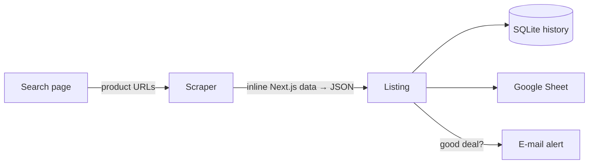

# Bike Scout

[](https://github.com/Guittagora/bike-scout/actions/workflows/ci.yml)


Bike Scout watches a [Buycycle](https://buycycle.com) search (the second-hand bike marketplace), keeps every
listing in a Google Sheet, records price and popularity history in SQLite, and e-mails you when a new
listing is priced well below its market value.

## Features

- **Structured scraping, not CSS selectors.** Buycycle is a Next.js app, and every product page inlines
  the data it was rendered from as "flight" chunks in `<script>` tags. Bike Scout reassembles those chunks
  and decodes the product JSON, which survives UI redesigns far better than CSS selectors.
- **Plays by the rules.** Only pages allowed by Buycycle's `robots.txt` are fetched. The site's internal
  RSC endpoints (`?_rsc=`) are disallowed there, so the scraper refuses to request them, and a test
  enforces this. Requests are spaced out with random delays.
- **Google Sheets as the dashboard.** One row per listing with an image preview, size, groupset, price,
  market price, hot-deal flag, favourites and status. Rows update in place on every run.
- **Price history.** Each listing's price and favourites are stored in SQLite; a snapshot is written
  only when something changes, and price drops are logged as events.
- **Sold detection.** Listings already in the sheet are re-checked first. Only a definite signal
  (HTTP 404/410, redirect away from the product page, or `status: sold`) marks a listing as sold;
  network errors and rate limits leave it untouched.
- **Deal alerts.** E-mail (HTML + plain text) when a new listing is below a configurable fraction of
  its market price, or flagged as a hot deal.
- **Safe by default.** `--dry-run` scrapes for real but writes nothing. Scraped text is escaped in
  e-mails and neutralised before it reaches the spreadsheet (no formula injection). Secrets stay in `.env`.

## How it works



| Module | Responsibility |
|---|---|
| [`scraper.py`](bike_scout/scraper.py) | HTTP session, search-page link extraction, Next.js flight-data decoding, robots.txt guard, availability probes |
| [`models.py`](bike_scout/models.py) | `Listing` dataclass and locale-aware price parsing (`€ 1.500`, `1,234.50`, `CHF 2'300`) |
| [`storage.py`](bike_scout/storage.py) | SQLite schema with in-place migrations, snapshots, events |
| [`sheets.py`](bike_scout/sheets.py) | Google Sheets client and an in-memory sheet with the same interface |
| [`notifier.py`](bike_scout/notifier.py) | Deal filters and SMTP alerts |
| [`pipeline.py`](bike_scout/pipeline.py) | Orchestrates one run; all I/O is injected, so it is unit-tested with fakes |
| [`cli.py`](bike_scout/cli.py) | Command-line interface and logging |

## Quick start

Requires Python 3.10+.

```bash
git clone https://github.com/Guittagora/bike-scout.git
cd bike-scout
./setup.sh        # venv, dependencies, config templates, tests
```

Then fill in:

1. **`config/settings.json`**: your Buycycle search URL (apply filters on the site, copy the URL), the
   sheet name and alert preferences. See [`settings.example.json`](config/settings.example.json).
2. **`.env`**:
   - `BUYCYCLE_COOKIE` (optional): the `Cookie` request header from your browser's DevTools while
     browsing buycycle.com, e.g. to keep your currency and locale preferences.
   - `GMAIL_APP_PASSWORD`: a Gmail [app password](https://myaccount.google.com/apppasswords) (only if alerts are enabled).
3. **`config/credentials.json`**: a Google Cloud service-account key with the Sheets and Drive APIs
   enabled. Share your spreadsheet with the service account's e-mail address.

## Usage

```bash
python -m bike_scout --dry-run --limit 3   # try it: scrape, write nothing
python -m bike_scout                       # real run
python -m bike_scout -c other.json -n 50 -v
```

Exit codes: `0` success, `1` Google Sheets unavailable, `2` configuration error, `3` blocked by the site.

To run it on a schedule, add a cron entry such as `0 */3 * * * cd /path/to/bike-scout && .venv/bin/python -m bike_scout`.

### Configuration reference

| Key | Default | Meaning |
|---|---|---|
| `search_url` | (required) | Buycycle search/listing page to monitor |
| `sheet_name` | | Google Sheet to write to |
| `max_listings` | `20` | Listings processed per run |
| `delay_seconds` | `2.5` | Pause between listings (plus 2 to 5 s random jitter per request) |
| `check_existing_first` | `true` | Re-check sheet rows for sold listings before searching |
| `check_method` | `head` | `head` checks the HTTP status only; `full` downloads and parses each listing |
| `email.only_good_deals` | `true` | Alert only when `price < market_price × good_deal_ratio` |
| `email.good_deal_ratio` | `0.8` | |
| `email.only_hot_deals` | `false` | Alert only for listings Buycycle flags as hot deals |

## Development

```bash
pip install -r requirements-dev.txt
pytest          # 61 tests, no network access
ruff check . && ruff format --check .
```

CI runs lint and tests on Python 3.10, 3.12 and 3.13 for every push.

## Current status

As of November 2026 buycycle.com serves a Cloudflare bot-protection challenge (`HTTP 403`,
`cf-mitigated: challenge`) to automated clients on its shop and product pages, with or without a session
cookie. Bike Scout detects this, stops the run cleanly and exits with code `3`. It does not try to get
around the protection. The parsing, storage, sheet and alert logic are covered by the offline test
suite and fixtures.

## Disclaimer

A personal, low-volume project for educational purposes. It makes a few dozen requests per run with
delays between them, follows `robots.txt` and does not circumvent access controls. Respect Buycycle's
terms of service and don't use it to redistribute their data.

## License

[MIT](LICENSE)
